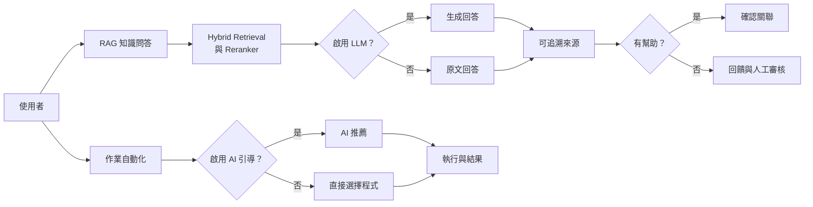
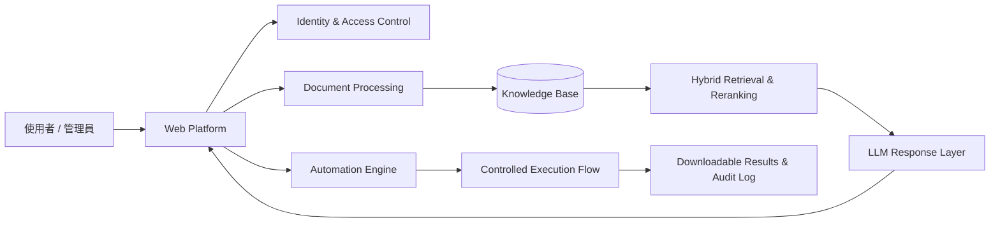

# Knowledge Hub

企業知識問答與自動化執行平台。此專案將文件匯入、RAG、權限管控、使用者回饋與作業自動化整合成一套完整的企業 AI 應用流程。

> **專案聲明**
>
> 此專案為本人開發之 Side Project，用於展示 AI Application Engineering、RAG／LLM 整合與作業自動化效果展示。專案中之呈現內容與資料，皆透過 AI 生成模擬。
>
> 基於資訊安全與智慧財產權考量，公開版僅呈現整理過的功能、技術概念與操作成果，恕不提供完整原始碼。

## 核心設計與運作方式

Knowledge Hub 的核心，在於保護內部資料的前提下使用 AI。平台可部署於內部並搭配本地模型，使文件與知識查詢內容不必上傳至第三方雲端，降低重要資料外洩的風險。

平台以使用者回饋與人工審核機制作為回答改善 Pipeline，持續修正知識關聯並提升回答準確性。

系統提供兩種回答模式，企業可依資料敏感度與使用需求選擇：

- **不啟用 LLM**：不透過LLM生成回覆，系統透過 Hybrid Retrieval 與 Reranker 找出最相關的文本，直接回傳 Rank 1 原始內容，可避免生成式模型產生的幻覺。

- **啟用 LLM**：系統將檢索出的 Top 5 文本傳遞 LLM，並組織出相關或有用的回答，生成回覆仍以原始文本內容為依據，限制模型禁止自由生成。啟用後能自動統整、組織文本內容，並提供模型改寫提問功能。

無論是否啟用 LLM，階會顯示候選文本、相似度、來源檔案及原始內容。使用者在取得回覆的同時，也能快速追溯答案來自哪一份文件及哪一段文本。

若當輪對話結果不正確，使用者可標記「無幫助」。啟用 LLM 的情況下，LLM 會改寫提問並重新檢索；若仍未解決，則提供最相似語意的相關問題供選擇。未啟用 LLM 則不支援問題改寫，直接進入相關問題推薦。

兩個模式下最終階段皆未能解決問題時，提問將被記錄至未解決問題清單，由管理者補充人工回應，或將問題關聯至正確文本／已確認相關問題，經確認後的關聯文本可供後續相似提問使用。

平台也整合作業自動化，可執行資料庫查詢、報表分析與產出、網路爬蟲等工作，結合 AI 依照使用者的自然語言需求，從中推薦自動化程式並引導操作。

整體需求整理成兩條主要流程：

## 核心能力

- **權限治理**：支援本地帳號、AD／LDAP 驗證，以及身分、群組與問答專區權限管理。
- **企業知識匯入**：支援試算表、簡報及結構化檔案，寫入知識庫前可預覽、調整內容、人工編輯與排除資料。
- **Hybrid Retrieval**：結合向量語意檢索、BM25 關鍵字檢索，並可配置 Reranker，各問答專區能獨立設置 LLM 回答設定。
- **答案可追溯**：保留 Top 5 候選、相似度與來源，使用者能展開查看匹配文本內容與文件依據。
- **三階段回饋機制**：依序提供初次回答、問題改寫重查與已確認相關問題推薦；仍無法解決時轉入人工處理清單。
- **AI 自動化**：支援 AI 推薦或使用者直接指定自動化程式，透過邏輯判斷確認參數與檔案收集，提供執行結果下載。
- **管理與稽核**：提供問答結果、未解決問題與自動化執行結果的紀錄，供管理者追蹤與管理。

## 功能展示

### 1. 登入與帳號治理

平台登入入口；管理者可管理本地帳號，並整合 AD／LDAP 驗證及權限配置。

AD／LDAP 為選擇性啟用。

### 2. 文件處理與寫入前確認

提供批次匯入資料功能，在寫入知識庫前完成欄位對應、內容預覽與修正，降低錯誤資料進入知識庫的風險。

### 3. 模型與檢索設定

各問答專區可獨立設定是否使用 LLM 生成回答；檢索流程支援語意搜尋、BM25、候選融合與 Reranker，並保留最終候選供使用者查證。

### 4. 可追溯問答與三階段改善

使用者可以展開檢視匹配文本、來源與相似度。當反饋無幫助時，系統依序執行問題改寫與推薦已確認相關問題；第三階段仍無法處理的問題，會交由管理者治理。

AI 改寫提問效果展示。

列出已確認相關問題，供使用者自行點閱。

未解決問題可由管理者人工維護。

紀錄使用狀況與統計結果。

### 5. AI 引導與指定執行自動化

AI 只會依據使用者擁有權限，且已開放的自動化清單提出建議，使用者確認後，平台按既定流程接續收集參數或檔案後執行程式。

以下「訂單資料匯出」案例展示參數輸入型自動化：平台依程式需求引導使用者輸入日期區間，再執行程式並提供結果下載。

自動化亦支援檔案輸入，使用者可上傳程式所需的檔案後執行處理。下圖以 Excel 為例，將前一步產出的訂單資料交給下一支分析程式，展示檔案在不同自動化之間的傳遞與加工流程。

### 6. 自動化執行紀錄

後台只記錄成功完成的工作，供管理者追蹤使用者、程式及輸出結果。

## 高階系統架構

架構刻意將 LLM 與最終系統動作分離：模型協助理解、改寫與生成文字，權限判斷、知識關聯及自動化執行則由後端規則控制。

## 個人主要實務經驗

| 分層 | 實際操作與應用經驗 |
| --- | --- |
| Application | Python、Dash、FastAPI API 串接與基礎應用 |
| Data | SQLite、文件解析、資料處理與索引管理 |
| AI / RAG | LlamaIndex、BM25、Hybrid Retrieval、Embedding 模型、ColBERT Reranker 設定與應用 |
| Model Integration | Hugging Face、OpenAI-compatible API、Ollama |
| Identity | 本地帳號、AD／LDAP、RBAC 權限設計 |
| Automation | Python 自動化、動態參數、檔案輸入與隔離執行環境 |
| Deployment | Linux、Docker 與容器化部署 |

此外，本專案的 Web 介面採用 React、TypeScript 與 Vite 建置，後端則使用 SQLAlchemy 進行資料庫存取。

## 個人實作重點

- 將文件處理、RAG、LLM、權限與自動化整合成完整 Web 平台，而非單一聊天範例。
- 設計多路檢索、融合排序、Reranker 與可追溯來源呈現。
- 將使用者回饋、問題改寫、相關問題及人工處理串成知識治理閉環。
- 以明確狀態與規則接管自動化執行，避免由 LLM 直接決定系統操作。
- 處理帳號權限、檔案生命週期、操作紀錄與企業內部部署等工程議題。

## 未公開範圍

此 GitHub 頁面用於求職作品展示，刻意省略：

- 完整原始碼與專案目錄結構
- 資料庫 schema、內部 API 路由及驗證實作細節
- 環境變數、模型端點、金鑰與正式部署參數
- 自動化程式儲存方式、伺服器路徑及執行環境細節
- 真實文件、帳號及任何工作期間成果

