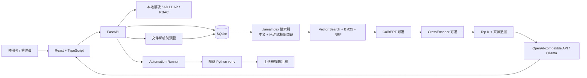

# AI_Platform

企業內部知識問答與自動化執行平台。系統將文件匯入、Hybrid Retrieval、LLM 回答、權限控管、使用者回饋與 Python 自動化整合在同一套 Web 應用中，目標不是只做聊天介面，而是建立一條可追溯、可管理、可部署的企業 AI 工作流程。

> 本儲存庫為作品展示與技術實作。畫面、測試帳號與範例資料皆應使用虛構或去識別化內容；請勿提交公司內部文件、API Key、`.env`、SQLite 資料庫或備份檔。

## 專案重點

- **企業級知識匯入**：支援 PPTX、XLS/XLSX、CSV、TSV、JSON，可先預覽、調整欄位，再批次寫入指定問答專區。
- **可追溯 RAG**：同時檢索本文、已確認的相關問題與 BM25 關鍵字結果，顯示 Top 5、相似度與來源檔案。
- **多階段排序**：向量檢索與 BM25 融合後，可依序使用 ColBERT late interaction 與 CrossEncoder reranker。
- **三階段回饋流程**：初次回答 → LLM 改寫後重查 → 已確認相關問題建議；仍無法解決時進入後台未解決問題清單。
- **AI 引導自動化**：LLM 只負責理解需求與推薦已授權程式，系統再以 `【程式名稱】` 契約接管確認、參數、檔案上傳與執行流程。
- **權限與治理**：本地帳號、AD/LDAP、角色、群組、專區權限、操作紀錄、問答分析、備份與還原。
- **本地與容器部署**：React production build 由 FastAPI 同站提供；可使用 Dockerfile，或在既有 Linux 容器內一次安裝與啟動。

## 系統架構



### RAG 查詢流程

1. 使用者只可查詢已授權的對話專區。
2. 系統分別查詢「本文向量」與「已確認相關問題向量」。
3. BM25 對資料名稱、本文與相關問題進行關鍵字檢索。
4. 將多路結果以語意分數、BM25、Reciprocal Rank Fusion 與多路命中加權合併。
5. 視後台設定使用 ColBERT、CrossEncoder 進行重排，最後保留 Top 5。
6. 未啟用 LLM 時，回答只使用 Rank 1 本文；啟用 LLM 時，以檢索內容生成回答，但仍保留來源與候選結果供查證。

預設 Embedding 為 [`iampanda/zpoint_large_embedding_zh`](https://huggingface.co/iampanda/zpoint_large_embedding_zh)。Reranker 採延遲載入，第一次查詢時才載入或下載。

## 使用者回饋與持續改善

```text
初次檢索與回答
  ├─ 有幫助：建立使用者問題與正確文本的對應
  └─ 無幫助
       ├─ LLM 已啟用：改寫問題並重新檢索
       └─ LLM 未啟用：直接進入下一階段
              ↓
       顯示 5 個已確認相關問題
              ↓
       仍無幫助 → 建立未解決問題
              ↓
       管理員輸入人工回應，或關聯正確文本／相關問題
```

這個流程將「LLM 生成」與「最終知識關聯」分開：模型可協助理解與改寫，但資料寫入與正確答案確認仍由明確規則及管理者操作控制。

## 自動化執行設計

管理員可將 Python 自動化程式指派給本地或 AD 使用者，並控制是否開放、使用哪一個隔離環境。程式透過 `context` 取得執行資訊：

- `context.user_id`：登入使用者識別。
- `context.parameters`：依程式宣告收集的參數。
- `context.files`：使用者已上傳檔案的伺服器路徑。
- `context.output_dir`：該使用者與程式的輸出目錄。

AI 引導模式中，LLM 只能看到目前使用者已被指派且已開放的自動化清單。當回覆出現有效的 `【程式名稱】`，前端狀態流程才接管執行：

```text
自然語言需求 → LLM 推薦【程式名稱】 → 使用者確認
             → 收集參數／檔案 → 隔離環境執行 → 提供下載連結
```

使用者也可以直接輸入 `【程式名稱】` 執行。只有成功完成的工作才會寫入自動化執行紀錄。上傳暫存檔與輸出檔可設定保留天數，後端會定期清理。

> 自動化 Python 環境提供套件隔離，但不是作業系統安全沙箱。正式環境仍應限制可登錄程式的人員、容器權限、網路範圍與可掛載目錄。

## 主要功能

| 模組 | 已實作功能 |
| --- | --- |
| 帳號與權限 | 本地帳號、AD/LDAP 額外驗證、角色、群組、專區成員與管理者 |
| 文件處理 | 單筆建立、批次拖曳、欄位對應、預覽修改、來源檔名記錄 |
| PPTX | 略過封面、依投影片標題與內容建構資料、同題合併、完整投影片圖片關聯 |
| 知識問答 | Hybrid Retrieval、Top 5、來源追溯、LLM／非 LLM 回答模式 |
| 檢索設定 | BM25、候選數量、ColBERT、CrossEncoder、測試檢索管線 |
| 品質回饋 | 有幫助關聯、問題改寫、相關問題建議、候選關聯審核 |
| 管理流程 | 未解決問題、人工回應、正確文本／問題關聯 |
| 分析治理 | 問答儀表板、查詢紀錄、篩選、匯出與刪除 |
| 自動化 | AI 推薦、指定執行、動態參數、檔案輸入、結果下載、執行紀錄 |
| 平台管理 | 品牌與外觀、Embedding 模型管理、資料備份／還原、系統初始化 |

## 技術棧

| 分層 | 技術 |
| --- | --- |
| Frontend | React、TypeScript、Vite、React Markdown、GFM |
| Backend | Python 3.11、FastAPI、Uvicorn、Pydantic、SQLAlchemy |
| Database | SQLite |
| RAG | LlamaIndex、Sentence Transformers、BM25、自訂融合排序 |
| Models | Hugging Face Embedding、ColBERT、CrossEncoder、OpenAI-compatible API、Ollama |
| Identity | HMAC 簽章登入 Token、本地帳號、ldap3、RBAC |
| Documents | openpyxl、xlrd、python-pptx、PowerPoint COM（Windows）、LibreOffice/Poppler（Linux） |
| Deployment | Docker multi-stage build、Conda 安裝腳本、FastAPI 靜態前端託管 |

## Demo 建議流程

此專案適合用以下故事線展示，而不是逐頁介紹 CRUD：

1. 登入、帳號管理與 AD/LDAP 權限設計。
2. 匯入測試文件，展示欄位辨識、預覽與寫入。
3. 展示 LLM 設定、BM25 + Vector Search + Reranker 管線。
4. 實際問答，呈現來源、Top 5 與三階段無幫助流程。
5. 在後台處理未解決問題，查看問答儀表板與紀錄。
6. 以自然語言讓 AI 推薦自動化，完成訂單資料匯出。
7. 直接指定另一支自動化，上傳前一步結果並產生統計表。
8. 查看只記錄成功工作的自動化執行紀錄。

## 專案結構

```text
.
├─ backend/
│  ├─ app/
│  │  ├─ main.py                 # API、權限檢查與應用生命週期
│  │  ├─ models.py               # SQLAlchemy 資料模型
│  │  ├─ schemas.py              # API schema
│  │  └─ services/
│  │     ├─ retrieval.py         # 雙索引、BM25、融合與 reranker
│  │     ├─ llm.py               # 問答、改寫與自動化推薦
│  │     ├─ pptx_import.py       # PowerPoint 解析與整頁圖片
│  │     ├─ automation_runner.py # 自動化載入與執行
│  │     └─ backup.py            # 備份與還原
│  ├─ data/                      # 執行資料；不應提交 Git
│  ├─ models/                    # 本地模型；不應提交 Git
│  ├─ .env.example
│  ├─ requirements.txt
│  └─ run.py
├─ frontend/
│  └─ src/
│     ├─ App.tsx                 # 平台與後台頁面
│     └─ AutomationWorkspace.tsx # 自動化對話與狀態流程
├─ Dockerfile
├─ install-and-start.sh
└─ start.sh
```

## 快速開始

### 1. 建立設定檔

```powershell
Copy-Item backend\.env.example backend\.env
```

至少填寫：

```dotenv
ADMIN_USERNAME=admin
ADMIN_PASSWORD=請設定至少12字元的高強度密碼
AUTH_SECRET=請設定至少32字元的隨機密鑰
FRONTEND_ORIGINS=http://localhost:3000,http://127.0.0.1:3000
APP_HOST=0.0.0.0
APP_PORT=8000
```

PowerShell 可用以下方式產生隨機密鑰：

```powershell
[Convert]::ToHexString([Security.Cryptography.RandomNumberGenerator]::GetBytes(48))
```

### 2. 本機開發

後端：

```powershell
cd backend
python -m venv .venv
.\.venv\Scripts\Activate.ps1
python -m pip install -r requirements.txt
uvicorn app.main:app --reload --reload-dir app --host 127.0.0.1 --port 8000
```

前端（另一個終端）：

```powershell
cd frontend
npm ci
npm run dev
```

`npm run dev` 只供開發。Vite 會讀取 `backend/.env` 中的前端相關設定。

### 3. Production build 驗證

```powershell
cd frontend
npm run build
npm run preview -- --host 0.0.0.0 --port 3000
```

`npm run preview` 只用於驗收建置結果，不是正式服務。正式模式由 FastAPI 同時提供 API 與 `frontend/dist`。

```powershell
cd backend
python run.py
```

### 4. 測試

```powershell
cd backend
python -m pytest -q
```

## Docker 部署

不需要 Docker Compose。

```powershell
docker build -t knowledge-hub .
docker run -d --name knowledge-hub --restart unless-stopped `
  --env-file backend/.env `
  -e APP_HOST=0.0.0.0 `
  -e APP_PORT=3000 `
  -p 3000:3000 `
  -v knowledge-hub-data:/app/backend/data `
  -v knowledge-hub-models:/app/backend/models `
  knowledge-hub
```

Dockerfile 使用 Node 22 建置前端，再以 Python 3.11 slim image 執行 FastAPI；正式 image 不需要 Node.js 或 Nginx runtime。

上面的 `-e APP_PORT=3000` 會覆寫本機開發用 `.env` 內可能存在的 `APP_PORT=8000`，使容器內服務與 `-p 3000:3000` 保持一致。

建議持久化：

- `/app/backend/data`：SQLite、向量索引、知識圖片、品牌素材、備份與自動化資料。
- `/app/backend/models`：Embedding 與 reranker 模型。

正式環境應在容器前方使用反向代理或 Load Balancer 終止 HTTPS，再轉送至平台 port。`FRONTEND_ORIGINS` 必須使用實際 HTTPS 網址。

## 在既有 Linux 容器內一鍵安裝

若容器由使用者自行建立，可先安裝 Miniconda 以及文件處理需要的系統套件：

```bash
apt-get update && apt-get install -y libreoffice-impress poppler-utils fonts-noto-cjk
cd /app
chmod +x install-and-start.sh
./install-and-start.sh
```

腳本會建立 `knowledge-hub` Conda 環境、安裝 Python 3.11/Node.js 22、安裝前後端套件、建置前端並啟動平台。已完成安裝與 build 後，可直接使用：

```bash
./start.sh
```

## 檢索與模型設定

預設值可在 `.env` 設定，啟動後也可由超級管理員在後台調整：

```dotenv
RETRIEVAL_BM25_ENABLED=true
RETRIEVAL_CANDIDATE_POOL=50
COLBERT_RERANKER_ENABLED=true
COLBERT_RERANKER_MODEL=jinaai/jina-colbert-v2
COLBERT_RERANKER_TOP_N=20
CROSS_ENCODER_RERANKER_ENABLED=false
CROSS_ENCODER_RERANKER_MODEL=BAAI/bge-reranker-v2-m3
CROSS_ENCODER_RERANKER_TOP_N=10
```

處理順序：

```text
本文向量 + 相關問題向量 + BM25
→ 融合候選
→ ColBERT Top N（可選）
→ CrossEncoder Top N（可選）
→ Top 5
```

兩個 reranker 同時啟用可能提升排序品質，但也會增加 CPU/GPU 延遲與記憶體需求。正式部署前應以自己的測試集評估，不應只依預設值決定。

模型授權需個別確認：`jinaai/jina-colbert-v2` 目前設定適合測試與研究用途，商業交付前必須重新審查其授權；`BAAI/bge-reranker-v2-m3` 採 Apache-2.0。

## 資料與備份

本機預設的重要路徑：

- SQLite：`backend/knowledge_platform.db`
- 向量索引：`backend/llamaindex_storage`
- 知識圖片：`backend/data/knowledge-assets`
- 自動化程式：`backend/data/automations/programs`
- 暫存上傳：`backend/data/automations/uploads`
- 執行輸出：`backend/data/automations/outputs`
- Embedding 模型：`backend/models/embeddings`
- Reranker 模型：`backend/models/rerankers`

平台備份包含帳號密碼雜湊、權限、設定、問答／執行紀錄與品牌素材，必須視為敏感資料並加密保存。向量索引可由 SQLite 內容重建。

## 安全注意事項

- 不要提交 `backend/.env`、資料庫、模型、備份、上傳檔或輸出檔。
- 不要在 README、截圖、commit history 或 issue 中公開 API Key、Token、真實帳號與內部主機名稱。
- 正式環境請使用 HTTPS、受信任反向代理、最小權限容器與入口層限流。
- 啟用 AD/LDAP 時，正式環境應使用 LDAPS/SSL。
- `FORWARDED_ALLOW_IPS` 只能設定受信任代理，不要任意使用 `*`。
- 自動化程式具有伺服器端 Python 執行能力，只能由受信任管理者部署。
- 預設 SQLite 適合單機部署；若未來需要多副本或高併發，應評估改用外部資料庫與共享物件儲存。

## 專案定位

這個專案主要展示以下 AI Application Engineering 能力：

- 將 RAG、LLM 與企業權限系統整合成可操作的完整產品流程。
- 自行設計多路檢索、融合排序、reranker 與可追溯來源呈現。
- 以使用者回饋與管理者確認建立可持續改善的知識治理閉環。
- 將 LLM 限制在語意理解與文字生成，並由確定性程式邏輯接管真正的自動化執行。
- 處理文件匯入、模型管理、部署、備份、稽核與資料生命週期等工程問題。

目前沒有在本 README 宣稱未經量測的準確率、延遲、使用人數或商業成效；正式評估應建立獨立測試集與可重現基準。
