# Knowledge Hub

企業知識問答與自動化執行平台。這個 Side Project 將文件匯入、可追溯 RAG、權限治理、使用者回饋與 Python 自動化整合成一套完整的企業 AI 應用流程。

> **作品聲明**
>
> 本專案由我在非工作時間獨立設計與開發，用於展示 AI Application Engineering、RAG／LLM 整合與系統工程能力。專案未使用、複製或揭露任職公司的原始碼、內部文件、資料、帳號、系統設定或其他機密資訊；畫面與資料均為自行建立的模擬內容。
>
> 基於資訊安全與智慧財產權考量，公開版本僅呈現經過整理的功能畫面、技術概念與操作成果，不提供完整原始碼、目錄結構、環境設定、部署密鑰及可直接重建正式環境的細節。

## 專案要解決的問題

企業導入生成式 AI 時，不只需要聊天介面，還必須處理文件維護、答案來源、存取權限、錯誤回饋、人工治理及既有工作流程整合。

Knowledge Hub 將需求整理成兩條主要流程：

```text
企業文件 → 解析與確認 → Hybrid Retrieval → 可追溯回答
       → 使用者回饋 → 人工治理 → 知識持續改善

自然語言需求 → AI 推薦已授權自動化 → 系統確認與收集輸入
             → 執行 Python 程式 → 結果下載與紀錄
```

## 核心能力

- **企業知識匯入**：支援試算表、簡報及結構化檔案，寫入前可預覽、調整欄位與排除資料。
- **Hybrid Retrieval**：結合向量語意檢索、BM25 關鍵字檢索、候選融合與可配置 Reranker。
- **答案可追溯**：保留 Top 5 候選、相似度與來源，讓使用者能查證回答依據。
- **三階段回饋機制**：初次回答、問題改寫重查、已確認相關問題推薦；仍無法解決時轉入人工處理。
- **權限治理**：支援本地帳號、AD／LDAP、角色、群組及問答專區權限。
- **AI 引導自動化**：AI 負責理解需求與推薦已授權程式，真正的確認、參數收集、檔案處理及執行由確定性程式流程接管。
- **管理與稽核**：提供問答分析、未解決問題處理及成功自動化執行紀錄。

## 功能展示

### 1. 登入與帳號治理

平台提供統一登入入口；管理者可管理本地帳號，並整合 AD／LDAP 驗證及權限配置。

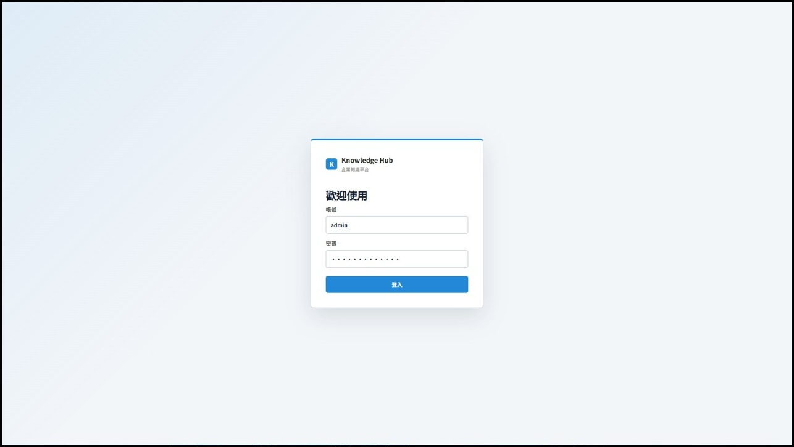

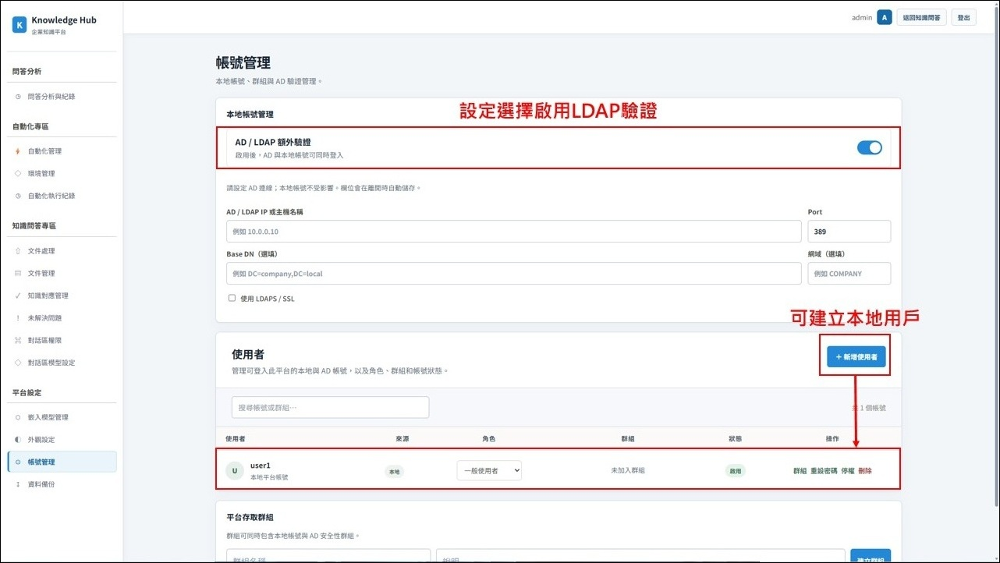

### 2. 文件處理與寫入前確認

管理者可批次匯入資料，在寫入知識庫前完成欄位對應、內容預覽與人工修正，降低錯誤資料直接進入檢索系統的風險。

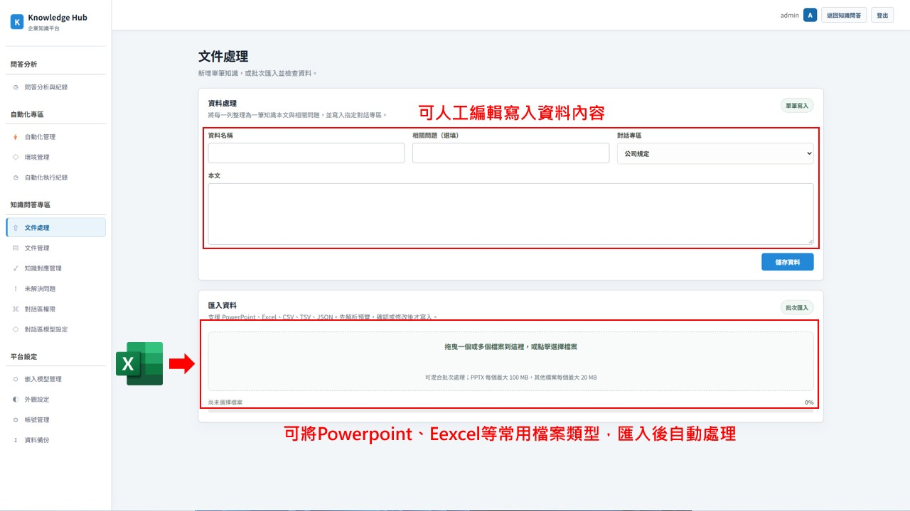

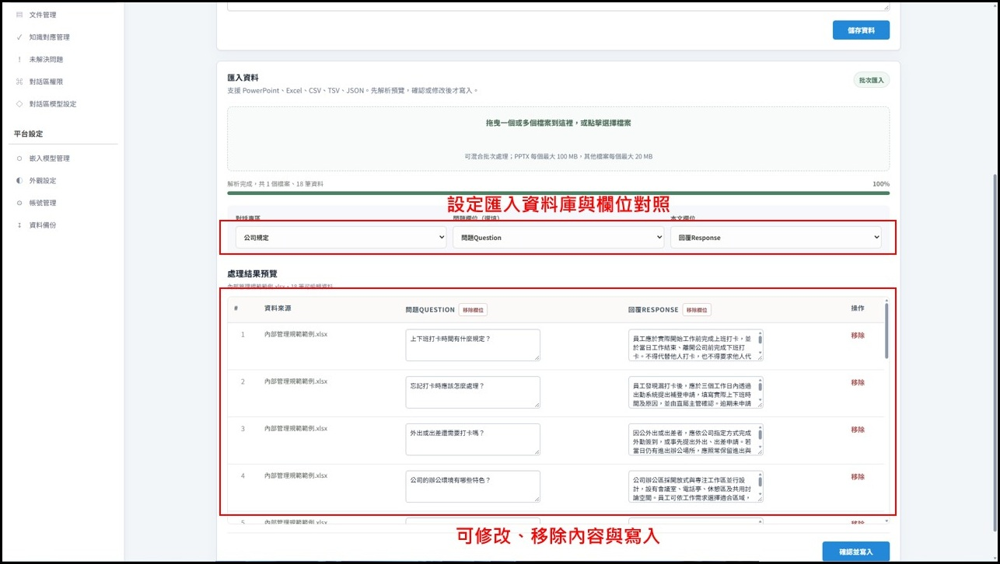

### 3. 模型與檢索設定

不同問答專區可設定是否使用 LLM 生成回答；檢索流程支援語意搜尋、BM25、候選融合與 Reranker，並保留最終候選供使用者查證。

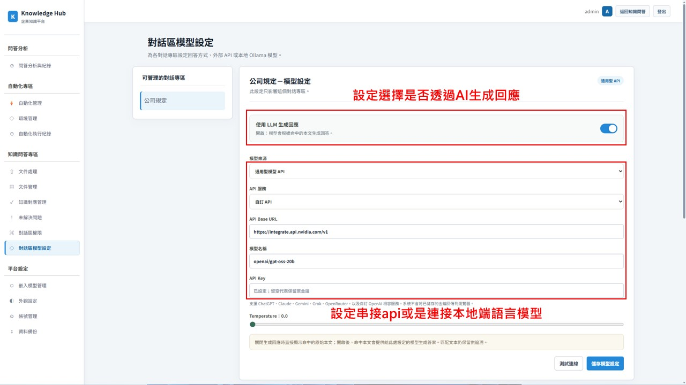

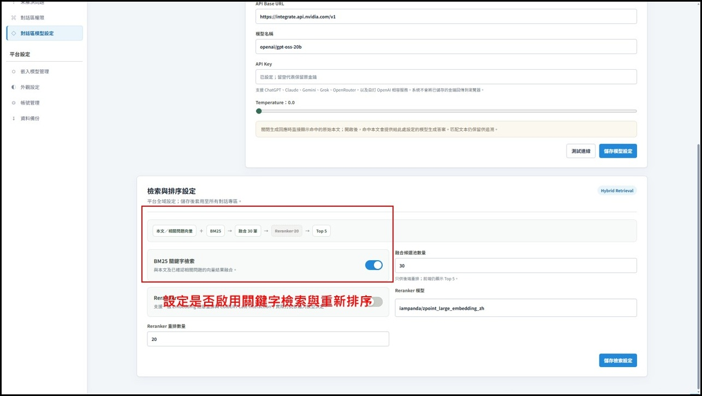

### 4. 可追溯問答與三階段改善

使用者可以展開檢視匹配文本、來源與相似度。當結果無幫助時，系統依序執行問題改寫與已確認相關問題推薦；第三階段仍無法處理的問題會交由管理者治理。

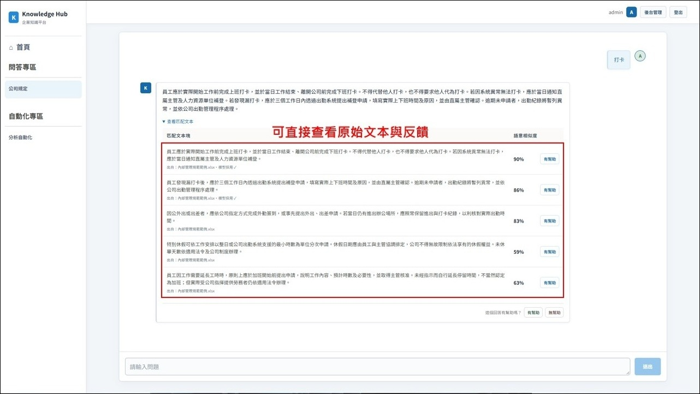

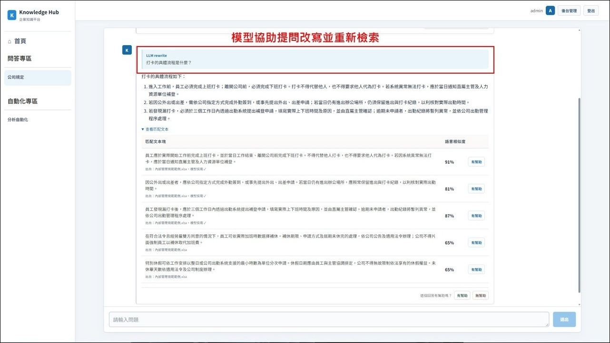

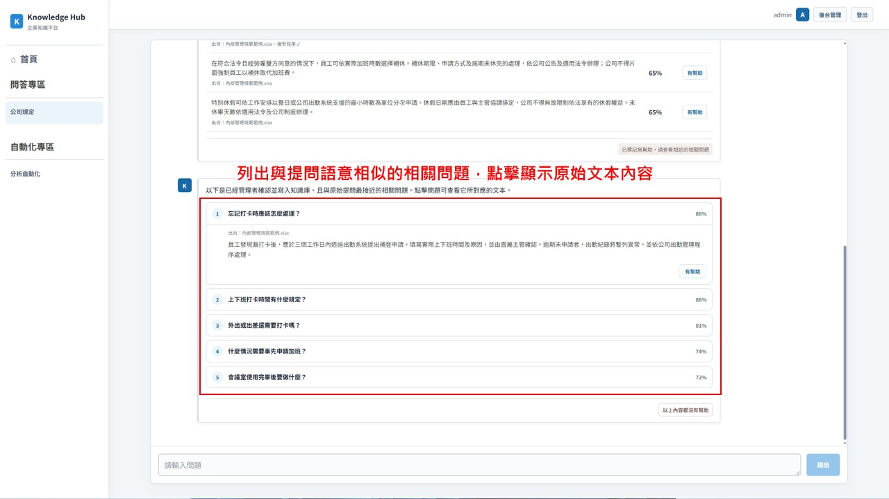

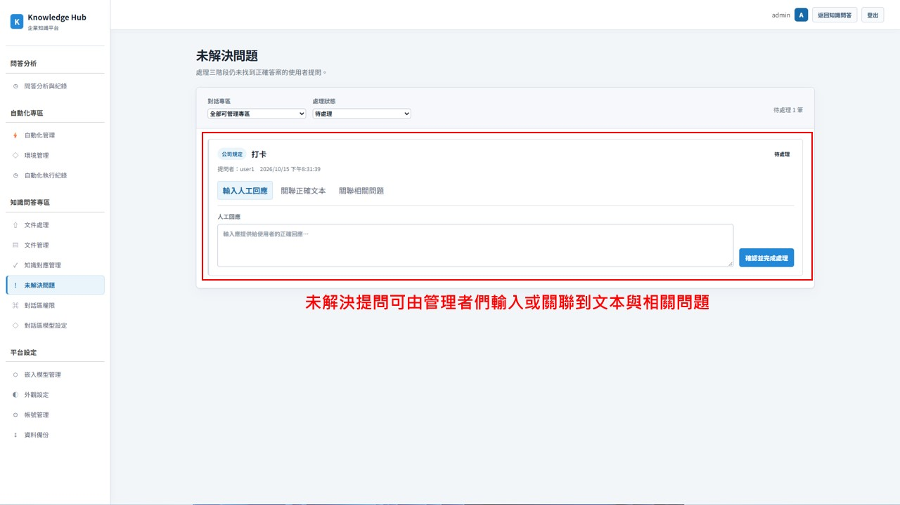

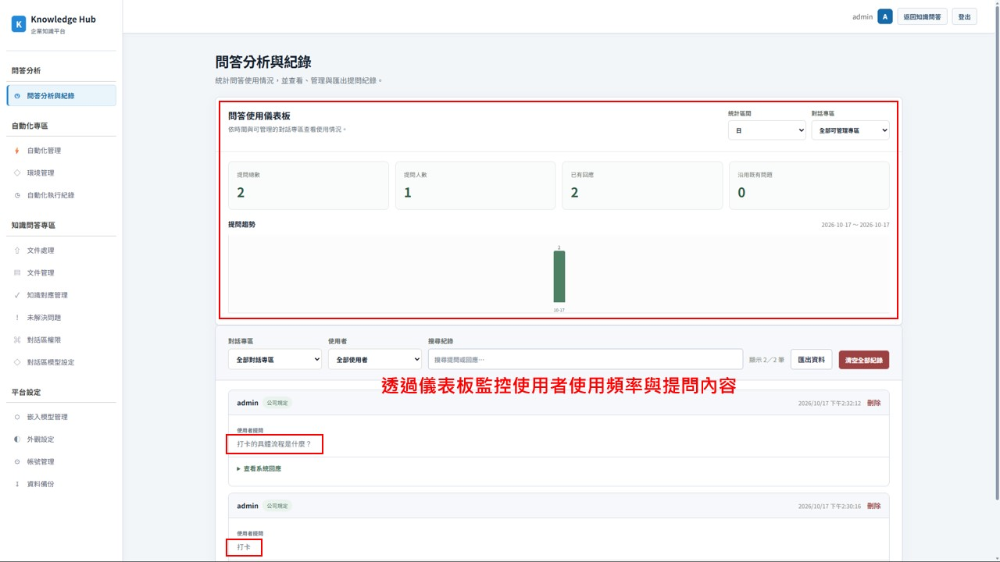

### 5. AI 引導與指定執行自動化

AI 只能依據使用者已獲授權且目前開放的自動化清單提出建議。使用者確認後，平台才進入參數或檔案收集流程並執行程式，避免讓模型直接控制後端行為。

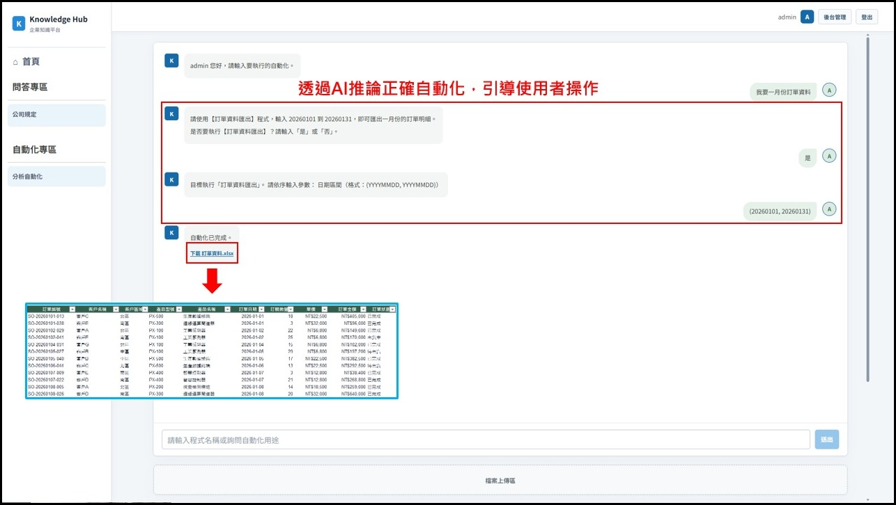

使用者也可以指定程式，將前一步產出的 Excel 交給下一支分析自動化，形成可操作的資料處理流程。

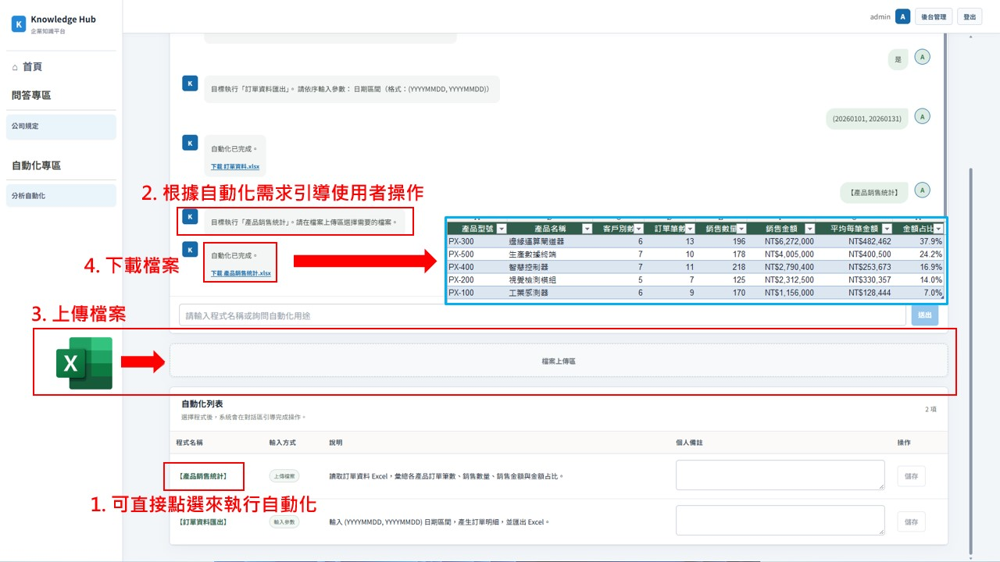

### 6. 自動化執行紀錄

後台只記錄成功完成的工作，供管理者追蹤使用者、程式及輸出結果。

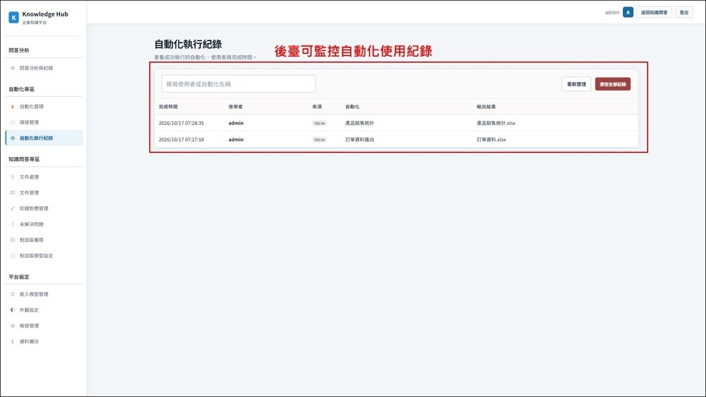

## 高階系統架構

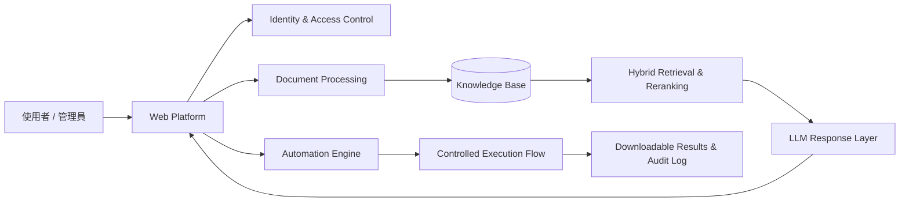

架構刻意將 LLM 與最終系統動作分離：模型協助理解、改寫與生成文字，權限判斷、知識關聯及自動化執行則由後端規則控制。

## 技術棧

| 分層 | 主要技術 |
| --- | --- |
| Frontend | React、TypeScript、Vite |
| Backend | Python、FastAPI、SQLAlchemy |
| Data | SQLite、文件解析與索引管理 |
| AI / RAG | LlamaIndex、Sentence Transformers、BM25、Hybrid Retrieval、Reranker |
| Model Integration | Hugging Face、OpenAI-compatible API、Ollama |
| Identity | 本地帳號、AD／LDAP、RBAC |
| Automation | Python 程式、動態參數、檔案輸入、隔離執行環境 |
| Deployment | Linux／Docker 導向的部署設計 |

## 個人實作重點

- 將文件處理、RAG、LLM、權限與自動化整合成完整 Web 平台，而非單一聊天範例。
- 設計多路檢索、融合排序、Reranker 與可追溯來源呈現。
- 將使用者回饋、問題改寫、相關問題及人工處理串成知識治理閉環。
- 以明確狀態與規則接管自動化執行，避免由 LLM 直接決定系統操作。
- 處理帳號權限、檔案生命週期、操作紀錄與企業內部部署等工程議題。

## 公開範圍

此 GitHub 頁面用於求職作品展示，刻意省略：

- 完整原始碼與專案目錄結構
- 資料庫 schema、內部 API 路由及驗證實作細節
- 環境變數、模型端點、金鑰與正式部署參數
- 自動化程式儲存方式、伺服器路徑及執行環境細節
- 真實公司文件、帳號、網路資訊及任何工作期間成果

如於面試中需要深入說明，我可以使用去識別化架構圖、操作畫面及不含機密的程式片段，說明設計取捨與實作方式。
